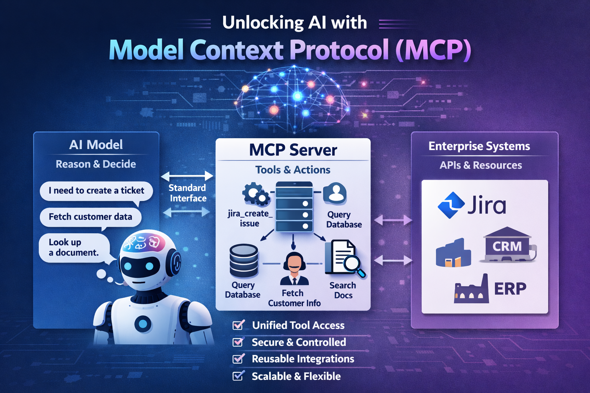

# hello-MCP-world

<div align="center">
  
</div>

A minimal, end-to-end example of the [Model Context Protocol (MCP)](https://modelcontextprotocol.io):
an MCP server that exposes a **"create Jira issue"** tool over HTTP, and a small command-line
client that calls that tool by speaking raw JSON-RPC to the server.

## What is MCP?

Model Context Protocol is a standard way for AI models and agents to discover and call tools,
APIs, and enterprise systems. Instead of writing a custom integration for every AI client, you
wrap a capability once as an MCP server, and any MCP-capable client (an LLM host, an agent, or a
plain script like the one here) can use it.

Why it matters:

- Unified access to external tools through one interface
- Clean separation between reasoning (the model) and execution (the tool)
- Reusable integrations across different AI clients
- Credentials stay on the server side, not in the model's context

## What's in this repo

| File | Purpose |
| --- | --- |
| `jiramcpserverhttp.py` | MCP server built with [FastMCP](https://gofastmcp.com). Exposes one tool, `jira_create_issue`, served over streamable HTTP at `http://127.0.0.1:8000/mcp`. The tool calls the Jira Cloud REST API (`POST /rest/api/3/issue`) using your Jira credentials. |
| `mcpclient.py` | Command-line MCP client. Opens a session with the server (`initialize`), then invokes the tool (`tools/call`) and prints the JSON result. Useful for seeing exactly what goes over the wire. |
| `images/mcp.png` | Overview diagram used in this README. |

## Architecture

```
 ┌──────────────────────────┐
 │  mcpclient.py            │   (or any MCP client / LLM host)
 └────────────┬─────────────┘
              │  JSON-RPC over HTTP (SSE responses)
              │  1. initialize        -> Mcp-Session-Id
              │  2. tools/call jira_create_issue
              ▼
 ┌──────────────────────────┐
 │  jiramcpserverhttp.py    │   FastMCP server on 127.0.0.1:8000/mcp
 │  tool: jira_create_issue │
 └────────────┬─────────────┘
              │  HTTPS + basic auth (email + API token)
              ▼
 ┌──────────────────────────┐
 │  Jira Cloud REST API v3  │   POST /rest/api/3/issue
 └──────────────────────────┘
```

### The `jira_create_issue` tool

| Argument | Type | Required | Description |
| --- | --- | --- | --- |
| `project_key` | string | yes | Jira project key, e.g. `SCRUM` |
| `summary` | string | yes | Issue title |
| `description` | string | yes | Issue body (sent to Jira as Atlassian Document Format) |
| `issue_type` | string | no | Issue type name, defaults to `Task` |

It returns `{"success": bool, "status_code": int, "data": <Jira response>}`.

## Setup

### Prerequisites

- Python 3.10+ (developed on Ubuntu 24.04)
- A Jira Cloud site and an account that can create issues in the target project
- A Jira API token. Create one at <https://id.atlassian.com/manage-profile/security/api-tokens>.

### 1. Install dependencies

```bash
pip install "fastmcp>=3.0.0rc1" httpx
```

### 2. Configure Jira credentials

The server reads these environment variables:

```bash
export JIRA_BASE_URL=https://your-domain.atlassian.net
export JIRA_EMAIL=you@example.com
export JIRA_API_TOKEN=<your Jira API token>
```

### 3. Start the MCP server

```bash
nohup python jiramcpserverhttp.py > server.out 2>&1 &
```

The server listens on `127.0.0.1:8000`. To use a different host or port, edit the
`mcp.run_http_async(...)` call in `jiramcpserverhttp.py`.

Check that it is running:

```bash
$ lsof -i :8000
COMMAND  PID USER   FD   TYPE  DEVICE SIZE/OFF NODE NAME
python  7028 root    6u  IPv4 1138597      0t0  TCP localhost:8000 (LISTEN)
```

Server logs go to `server.out`.

### 4. Create a Jira issue with the client

```bash
python mcpclient.py \
  --project SCRUM \
  --summary "Ticket via CLI" \
  --description "Created using MCP HTTP client" \
  --type Task
```

| Flag | Required | Description |
| --- | --- | --- |
| `--project` | yes | Jira project key |
| `--summary` | yes | Issue summary |
| `--description` | yes | Issue description |
| `--type` | no | Issue type, defaults to `Task` |

The client connects to the URL in `MCP_URL`, which is hardcoded to `http://127.0.0.1:8000/mcp` in
`mcpclient.py`. Change it there if your server runs somewhere else.

#### Expected output

The client prints debug information for the session handshake, then the tool result. On success
the result includes the new issue's key:

```
<Response [200 OK]>
{
  "raw_text": "event: message\r\ndata: {\"jsonrpc\":\"2.0\",\"id\":1,\"result\":{\"content\":[...],\"structuredContent\":{\"success\":true,\"status_code\":201,\"data\":{\"id\":\"10442\",\"key\":\"SCRUM-79\",\"self\":\"https://your-domain.atlassian.net/rest/api/3/issue/10442\"}},\"isError\":false}}\r\n\r\n"
}
```

Here, `"key": "SCRUM-79"` is the issue that was created.

### Trying it without the Python client

You can do the same handshake with `curl`:

```bash
curl -i -X POST http://127.0.0.1:8000/mcp \
  -H "Content-Type: application/json" \
  -H "Accept: application/json, text/event-stream" \
  -d '{"jsonrpc":"2.0","id":1,"method":"initialize","params":{"protocolVersion":"2024-11-05","capabilities":{},"clientInfo":{"name":"test","version":"1.0"}}}'
```

Copy the `mcp-session-id` response header, then send it as the `Mcp-Session-Id` header on a
`tools/call` request.

## Troubleshooting

- **`401 Unauthorized` from Jira**: check `JIRA_EMAIL` and `JIRA_API_TOKEN`, and make sure the
  variables were exported in the shell that started the server.
- **`400 Bad Request` from Jira**: the project key or issue type probably doesn't exist, or the
  project requires extra fields.
- **Connection refused from the client**: the server isn't running or is on a different port.
  Check `server.out` and `lsof -i :8000`.
- **Missing session ID error**: the server must be reachable over streamable HTTP, and the
  `initialize` call must succeed before `tools/call`.

## Security notes

- Never commit your API token. Keep it in environment variables or a secrets manager.
- The server binds to `127.0.0.1` by default and has no authentication of its own. Anyone who can
  reach it can create issues with your Jira credentials, so don't expose it on a public
  interface without adding auth in front of it.
